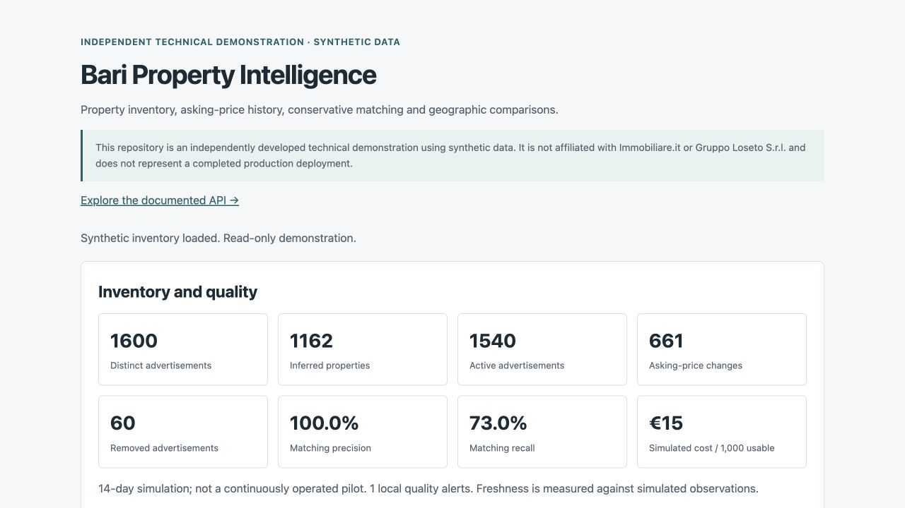
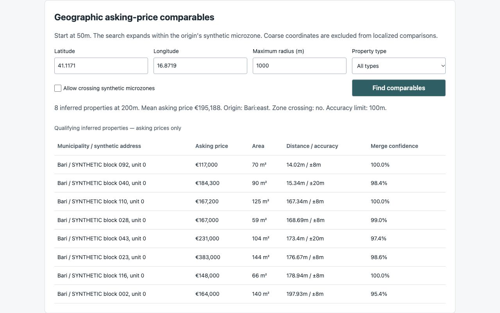
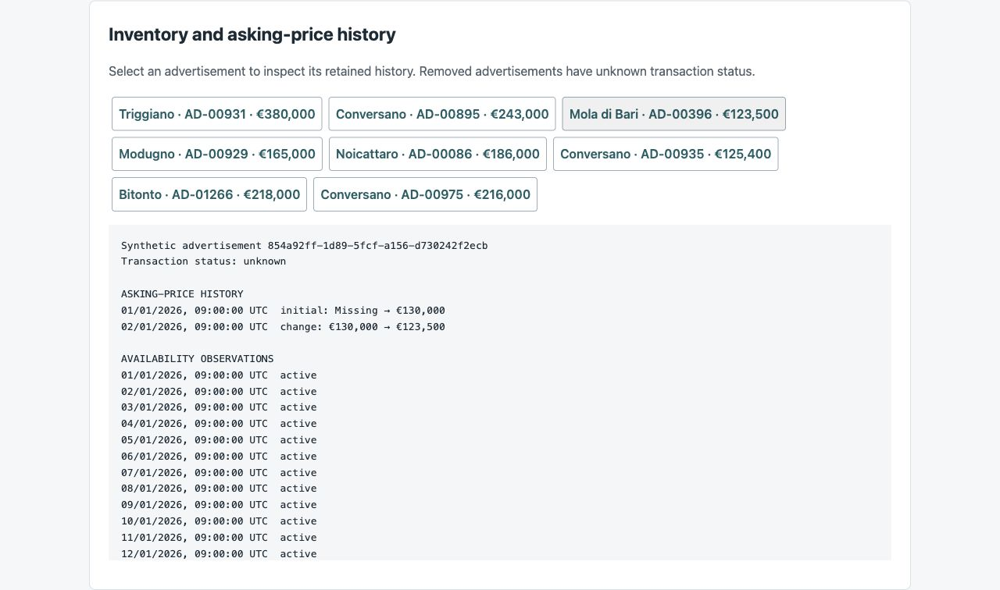
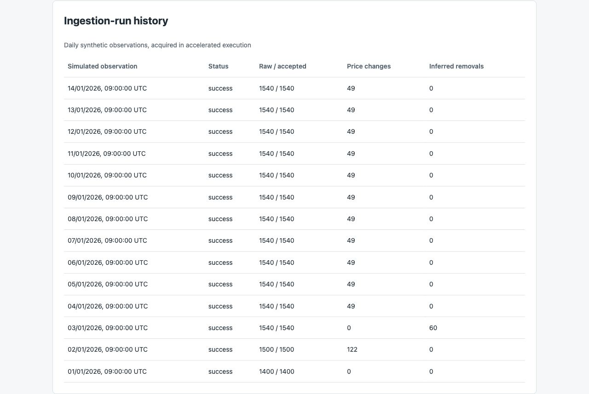
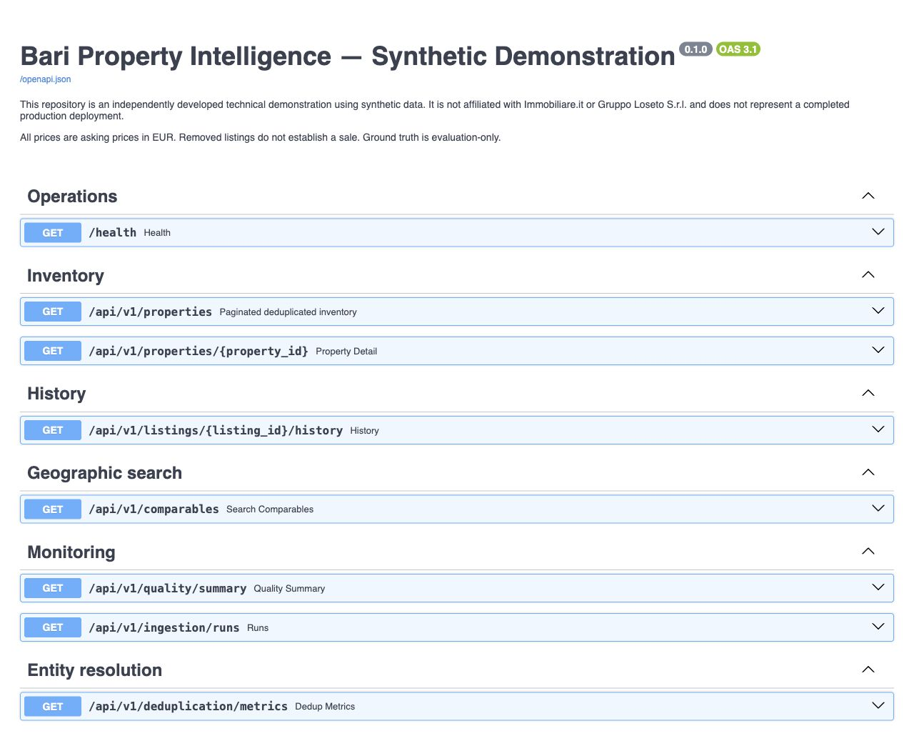

# Working demonstration screenshots

Captured on **12 October 2026** from the running Docker/FastAPI/PostGIS application using its browser-rendered UI. The database contains the accelerated **1–14 January 2026 synthetic simulation**, not a continuously operated live pilot. These are genuine application captures, not mockups. All property data is synthetic; prices are asking prices and operating-cost figures are simulated.

## 1. Inventory and quality overview

Shows 1,600 distinct advertisements, 1,162 conservatively inferred properties, 1,540 active advertisements, 661 retained asking-price changes and 60 removed advertisements. Precision/recall refer only to the synthetic evaluation dataset. The UI rounds the simulated unit cost for display; the reproducible report retains its precision.

## 2. Geographic asking-price comparables

The default search begins at 50m and expands to 200m to find eight inferred properties. This capture shows the origin microzone, explicit crossing control, asking prices, distances, declared coordinate accuracy and merge confidence. Microzone boundaries are fictional demonstration boundaries.

## 3. Retained asking-price and availability history

A selected fictional advertisement retains its change from EUR 130,000 to EUR 123,500, together with daily availability observations. Its transaction status remains `unknown`. The scrollable history continues through the final simulated observation; this capture preserves the visible UI without altering its contents.

## 4. Ingestion-run history

Fourteen daily synthetic observations were processed in accelerated execution. The table exposes accepted/raw counts, asking-price changes and inferred removals; it is not evidence of fourteen days of continuous real-world operation.

## 5. Live OpenAPI documentation

The running FastAPI service serves all eight required endpoints and public request/response documentation. The synthetic-data disclaimer and asking-price/removal semantics are visible above the endpoint list.

## Reproducing these views

Run `docker compose up --build -d`, then `docker compose exec api python -m app.cli run-demo --days 14`. Open the application at `http://localhost:8089/` and its API documentation at `http://localhost:8089/docs`. The captured viewport was the browser's default desktop viewport (1,280 pixels wide). The overview is a viewport screenshot; other captures show complete rendered sections or the endpoint list. No application data, labels or values were edited for the screenshots.

See [validation evidence](VALIDATION.md), [sample 14-day report](../reports/sample-fourteen-day.md) and [production gaps](PRODUCTION_GAPS.md) for the evidence and limits behind these views.
